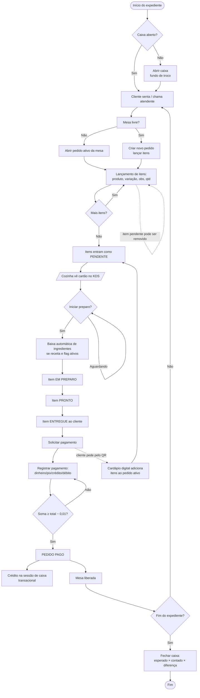
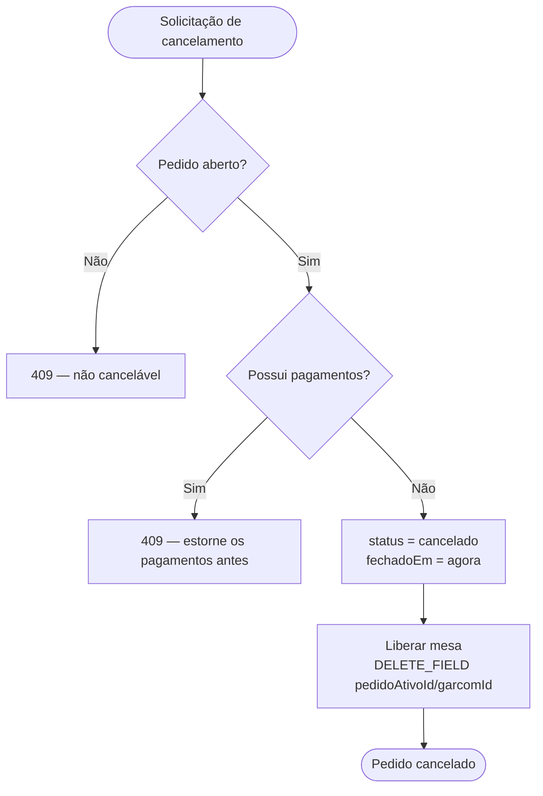
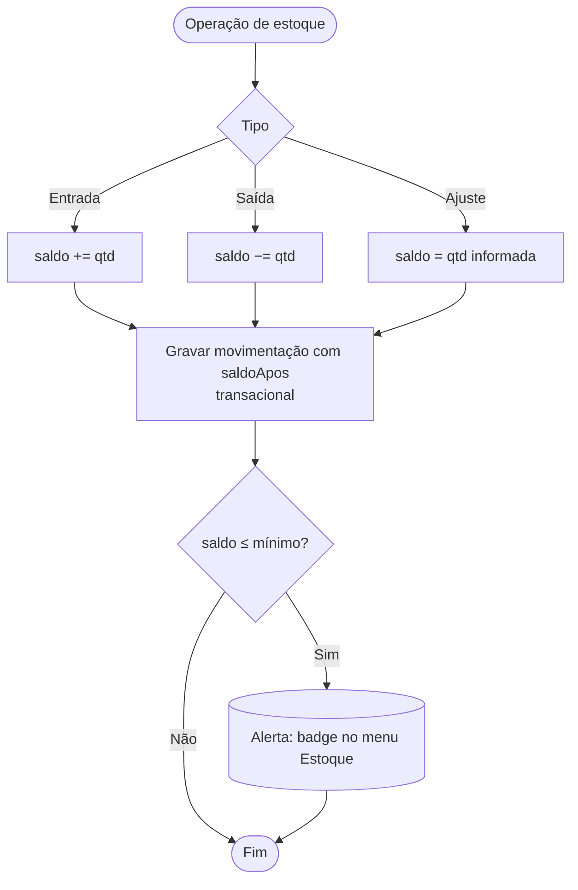
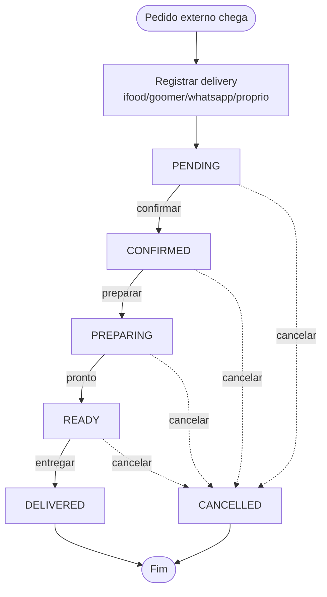
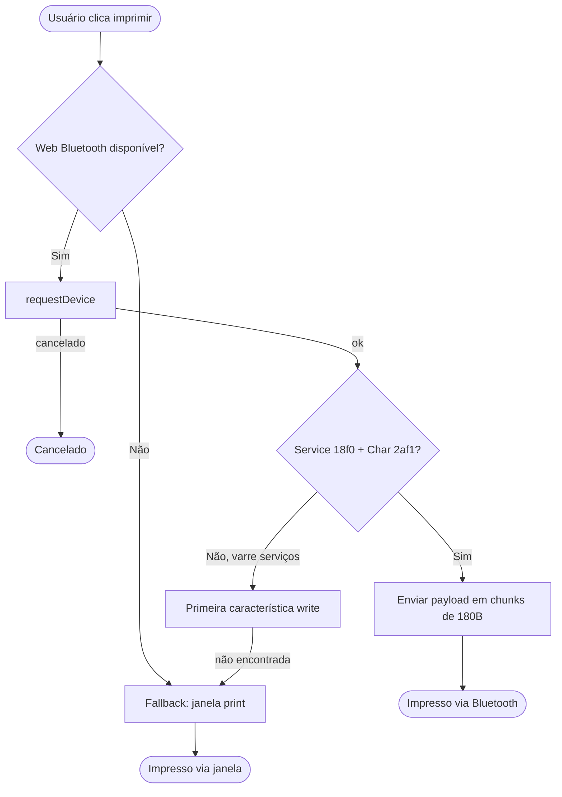

# Diagrama de Atividades — PDV Lanchonete v2

## 1. Atividade principal: ciclo da venda no salão (mesa)

## 2. Cancelamento de pedido

## 3. Movimentação de estoque manual

## 4. Fluxo do delivery

> Transições fora dessas setas são rejeitadas pelo backend (409) — ver RN-16.

## 5. Impressão (decisão em tempo real)

