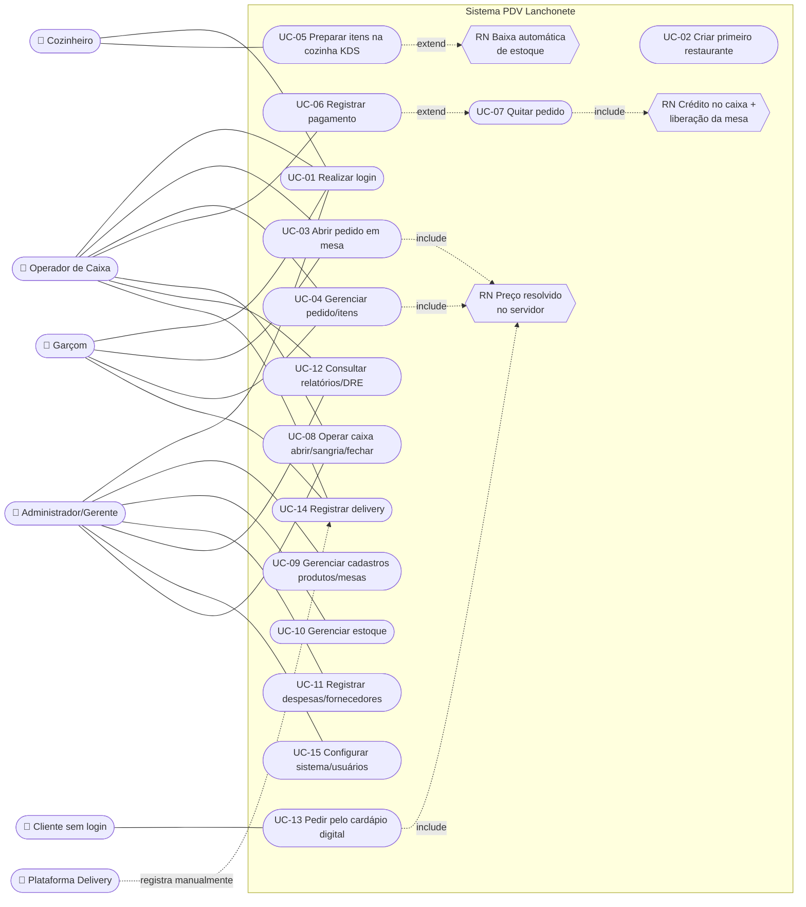

# Diagrama de Casos de Uso — PDV Lanchonete v2

> Renderizável em GitHub/GitLab/VS Code (Mermaid). A especificação textual detalhada está em `../01-planejamento/especificacao-casos-de-uso.md`.

## Observações

- **Generalização de atores:** `Administrador` herda as capacidades de todos os demais papéis (matriz RN-02).
- **«include»** — preço sempre do servidor faz parte de qualquer lançamento de item (local, digital ou delivery).
- **«extend»** — a quitação (UC-07) é um desdobramento automático do pagamento (UC-06) quando o saldo cobre o total; a baixa de estoque (R1) dispara apenas na transição `pendente → preparo` e se a receita existir.
