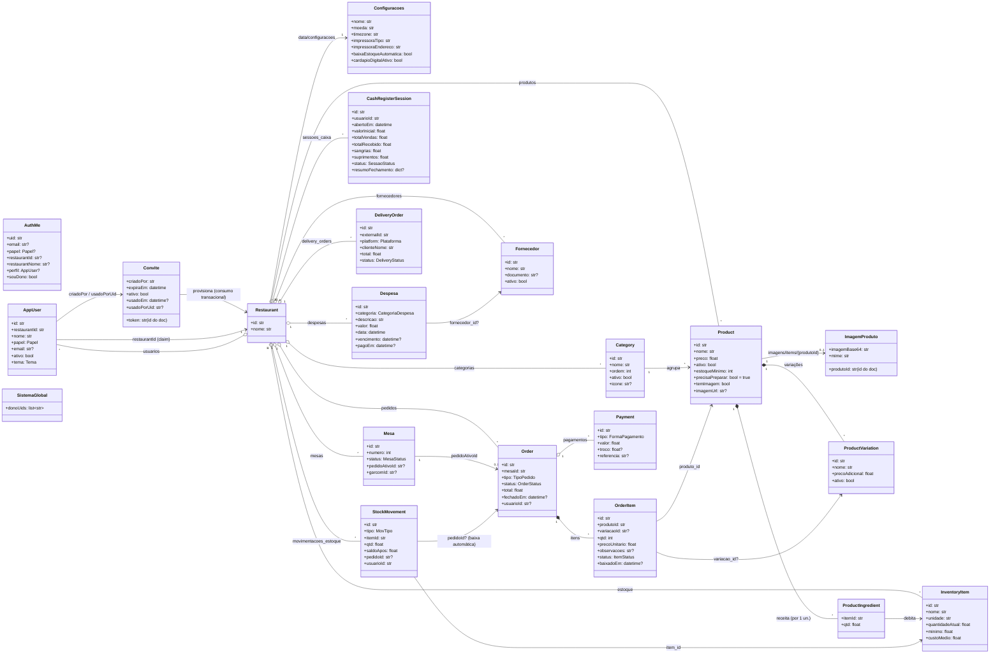

# Diagrama de Classes — PDV Lanchonete v2

Modelo conceitual espelhado nos modelos Pydantic (`backend/app/models/models.py`) e nos tipos TypeScript (`frontend/src/types/index.ts`). Atributos em camelCase como trafegam na API.

> **Top-level (fora do tenant):** `onboarding/{uid}`, `sistema/global` (`SistemaGlobal`) e `convites/{token}` — acessíveis só via Admin SDK / guard de dono da plataforma.

## Enumerações (domínios de valor)

| Enum | Valores |
|---|---|
| `Papel` | admin · gerente · caixa · garcom · cozinha |
| `Tema` | claro · escuro |
| `MesaStatus` | livre · ocupada · reservada · inativa |
| `TipoPedido` | local · delivery · balcao |
| `OrderStatus` | aberto · pago · cancelado |
| `ItemStatus` | pendente · preparo · pronto · entregue · cancelado |
| `FormaPagamento` | dinheiro · pix · credito · debito |
| `SessaoStatus` | aberto · fechado |
| `MovTipo` | entrada · saida · ajuste |
| `Plataforma` | ifood · goomer · whatsapp · proprio |
| `DeliveryStatus` | pending · confirmed · preparing · ready · delivered · cancelled |
| `CategoriaDespesa` | insumo · folha · conta_fixa · outra |

## Notas

- **Composição** (`*--`) para listas embutidas no documento do pedido (itens, pagamentos) e no produto (variações, ingredientes) — padrão agregado no Firestore.
- **Associação por id** (`-->`) entre coleções distintas — não há FK física; integridade é garantida pelas regras de serviço.
- `AuthMe` é um DTO de sessão (não persistido); `Configuracoes` é documento único (`data/configuracoes`), os demais ficam em `data/{colecao}/items/{id}`.
