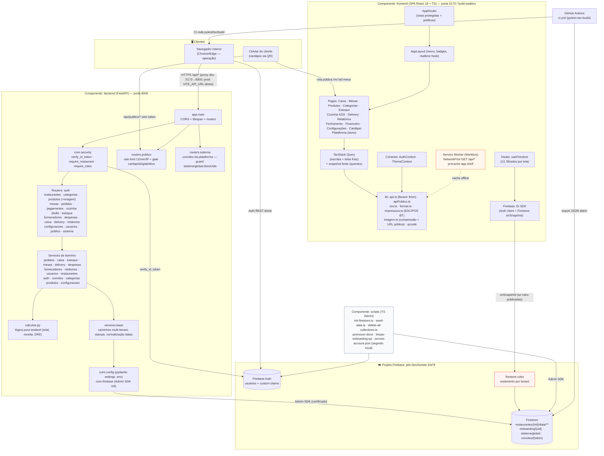

# Diagrama de Componentes — PDV Lanchonete v2

## Tabela de componentes

| Componente | Tecnologia | Responsabilidade | Interfaces expostas |
|---|---|---|---|
| **frontend** | React 18, Vite 5, Tailwind 4 | UI da operação e do cliente; PWA | HTTP `/api/*`; Firebase Auth JS; Web Bluetooth |
| **backend** | FastAPI, Python 3.12 | Regras de negócio, autorização, transações | REST `/api/*` (18 routers), `GET/HEAD /health` |
| **Firebase Auth** | Serviço gerenciado | Identidade, ID tokens, claims | SDK client (login) e Admin (claims/usuários) |
| **Firestore** | Serviço gerenciado | Persistência multi-tenant + plataforma (`sistema/global`, `convites`) | Caminho `restaurantes/{rid}/data/**` |
| **firestore.rules** | Rules v2 | Isolamento no acesso direto do cliente | Deploy `firebase deploy --only firestore:rules` |
| **scripts** | Node TS + firebase-admin | Provisionar/dados demo/limpar ambiente/gestão de donos | CLI npm (`npm run init|seed|promover-dono|limpar-onboarding-qa`) |
| **GitHub Actions** | Workflows YAML | CI (pytest+tsc+build) | Push/PR |

## Pontos de integração notáveis

1. **Proxy de desenvolvimento** — o dev server do Vite repassa `/api` para `127.0.0.1:8000` (`vite.config.ts`). Em produção NÃO há rewrite (exigiria Blaze): o frontend chama a URL direta da Render via `VITE_API_URL` embutido no build + CORS.
2. **Dois caminhos ao Firestore** — escritas SEMPRE pela API (Admin SDK); leituras em tempo real opcionais direto do cliente (restritas pelas rules; ausência não quebra o app).
3. **Impressão é 100% cliente** — o backend não imprime; o navegador fala com a impressora térmica Bluetooth.
4. **Imagem do produto** — bytes públicos fora do rate limit/gate (`` não envia Authorization).
