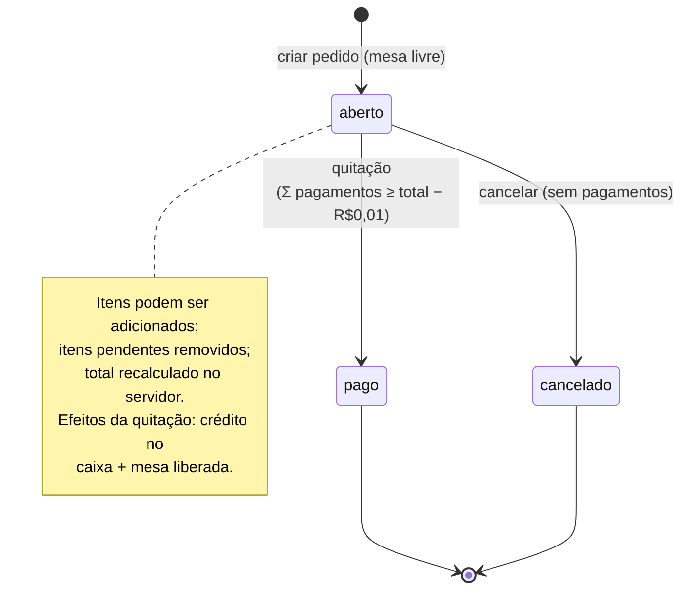
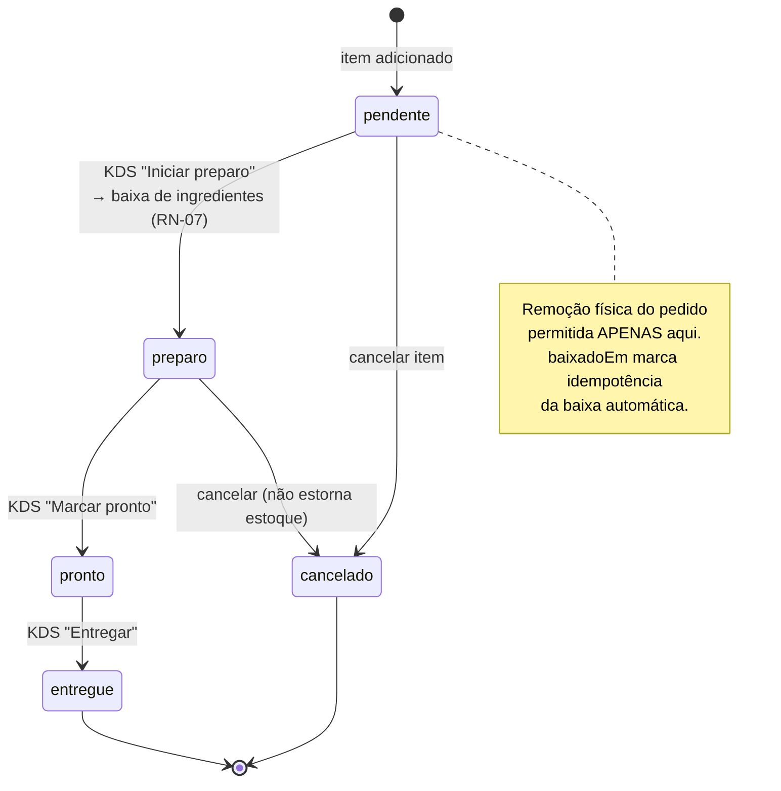
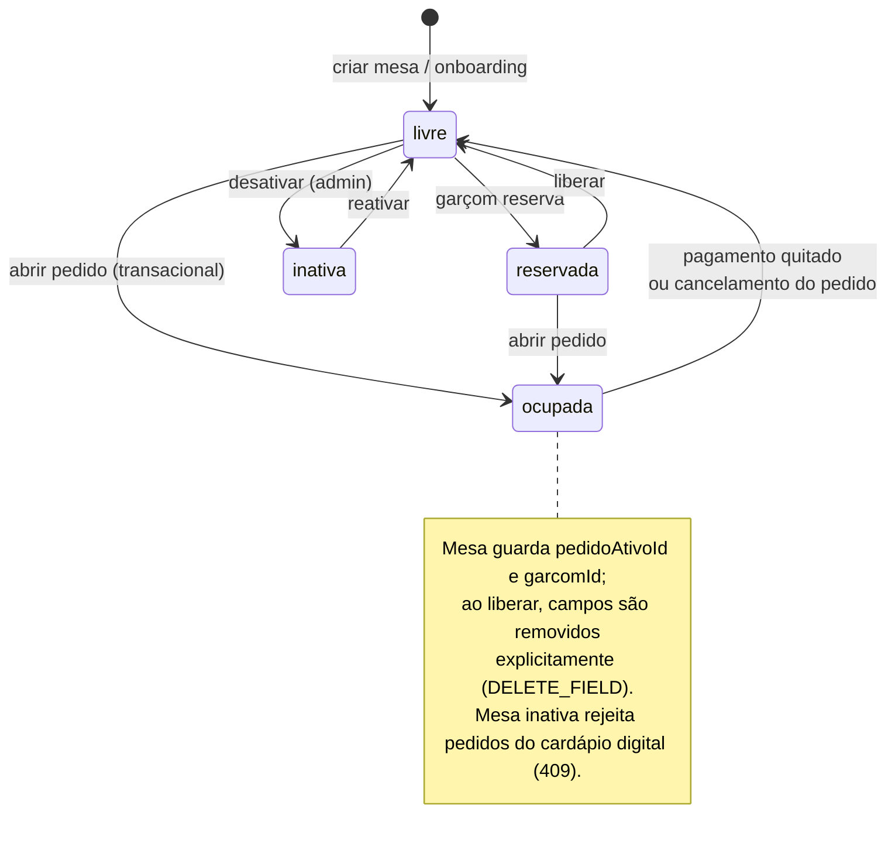
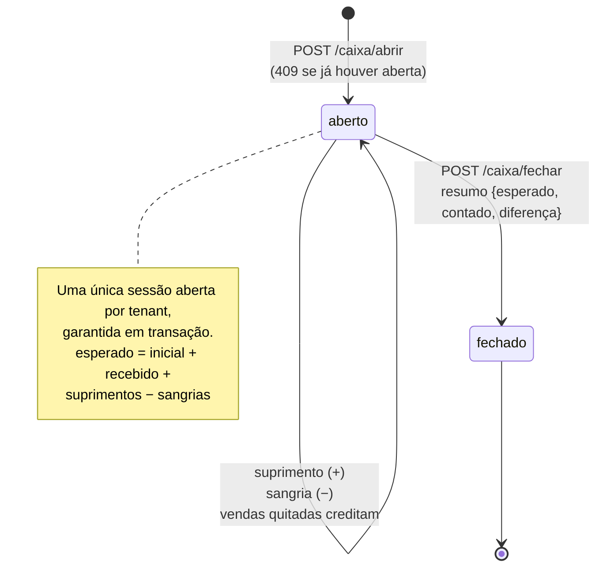
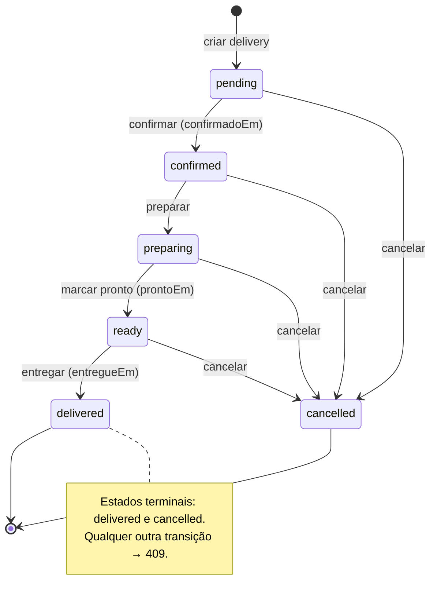
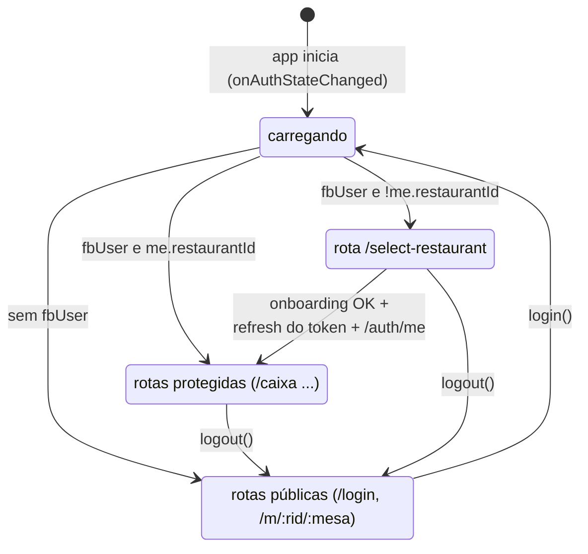

# Diagramas de Estados — PDV Lanchonete v2

## 1. Pedido (`Order.status`)

## 2. Item do pedido (`OrderItem.status`)

## 3. Mesa (`Mesa.status`)

## 4. Sessão de caixa (`CashRegisterSession.status`)

## 5. Delivery (`DeliveryOrder.status`) — máquina com transições restritas

## 6. Autenticação no frontend (`AuthContext`)

