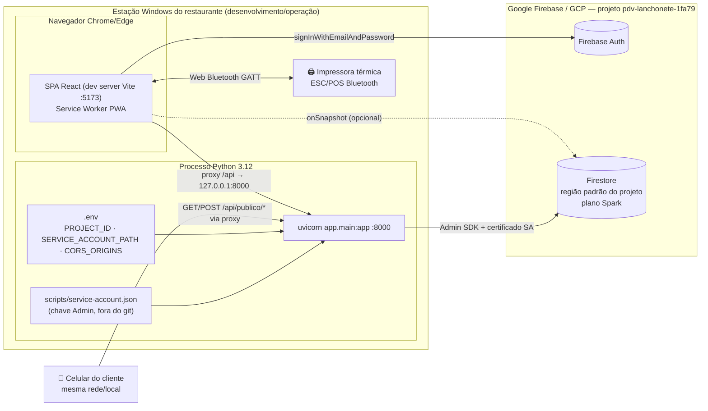
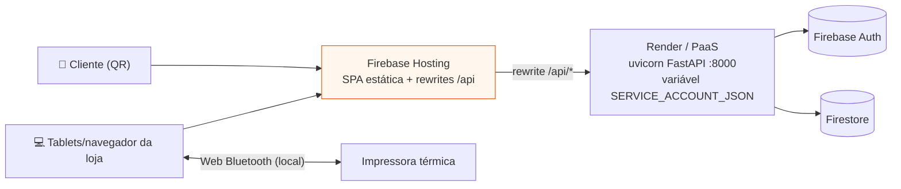

# Diagrama de Implantação (Deployment) — PDV Lanchonete v2

## Cenário atual — desenvolvimento local (implementado)

## Cenário alvo — produção planejada

### Requisitos de implantação por nó

| Nó | Artefato | Configuração necessária |
|---|---|---|
| Navegador da operação | Build estático do frontend | HTTPS obrigatório para Web Bluetooth; PWA instalável; apontar `/api` para o backend (proxy/rewrite) |
| Servidor de aplicação | `backend/` + `.venv` | Python 3.12; pacote **tzdata**; variáveis `PROJECT_ID`, `SERVICE_ACCOUNT_PATH` (ou segredo equivalente), `CORS_ORIGINS` com origens de produção; porta 8000 atrás de TLS no edge |
| Celular cliente | Rota pública `/m/:restaurantId/:mesaId` | Sem auth; rate limit ativo no backend; cardápio digital habilitado nas configurações |
| Impressora térmica | ESC/POS Bluetooth LE | Emparelhada com o SO do dispositivo que imprime; service UUID `18f0`; fallback janela print quando indisponível |
| Firebase | Auth + Firestore | Usuários com claims `{restaurantId, papel}`; **regras publicadas** (`firebase deploy --only firestore:rules`) |

### Considerações

- **Sem estado no backend** — toda persistência é Firestore; a API pode escalar horizontalmente sem sessão local.
- **TLS** — Web Bluetooth e Service Worker exigem contexto seguro (HTTPS ou localhost).
- **Custo** — plano Spark suporta o piloto; limites de leitura/escrita diários devem ser monitorados antes de escalar.
- **Backup/DR** — export programado do Firestore (recomendado antes do go-live).
