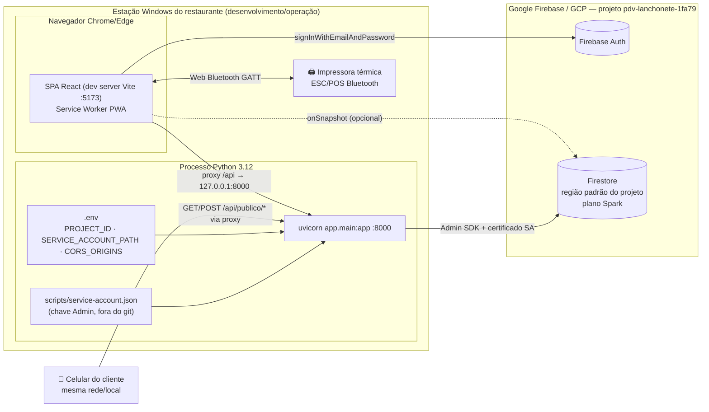
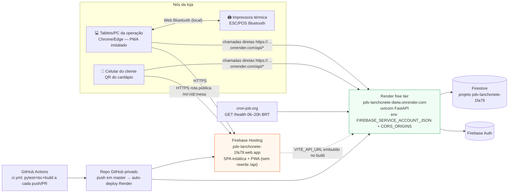
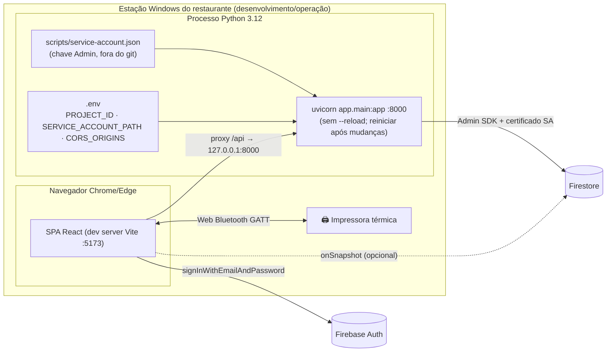

# Diagrama de Implantação (Deployment) — PDV Lanchonete v2

## Cenário atual — desenvolvimento local (implementado)

## Cenário atual — produção (ATIVO desde 2026-08-23)

## Cenário de desenvolvimento local (implementado)

### Requisitos de implantação por nó

| Nó | Artefato | Configuração necessária |
|---|---|---|
| Navegador da operação | Build estático do frontend | HTTPS obrigatório para Web Bluetooth; PWA instalável; dev usa proxy `/api`, produção chama a Render por URL (`VITE_API_URL` no build) |
| API na Render | `backend/` (free tier, dorme ~15 min) | Python 3.12; **tzdata**; envs `FIREBASE_SERVICE_ACCOUNT_JSON` (JSON completo), `CORS_ORIGINS=https://pdv-lanchonete-1fa79.web.app`; dependências com **pin exato** (bug 12); `/health` GET+HEAD |
| Celular cliente | Rota pública `/m/:restaurantId/:mesaId` | Sem auth; rate limit ativo no backend; cardápio digital habilitado nas configurações |
| Impressora térmica | ESC/POS Bluetooth LE | Emparelhada com o SO do dispositivo que imprime; service UUID `18f0`; fallback janela print quando indisponível |
| Firebase | Auth + Firestore + Hosting | Usuários com claims `{restaurantId, papel}`; **regras publicadas**; Authorized Domains com `pdv-lanchonete-1fa79.web.app` |
| CI/CD e monitoramento | GitHub Actions + cron-job.org | `ci.yml` (pytest+tsc+build), keep-alive GET `/health` 06–20h BRT |

### Considerações

- **Sem estado no backend** — toda persistência é Firestore; a API pode escalar horizontalmente sem sessão local.
- **TLS** — Web Bluetooth e Service Worker exigem contexto seguro (HTTPS ou localhost).
- **Custo** — plano Spark suporta o piloto; limites de leitura/escrita diários devem ser monitorados antes de escalar.

- **Smoke pós-deploy** — `/health` é estático: sondar também um endpoint que LEIA Firestore (ex.: cardápio público).
