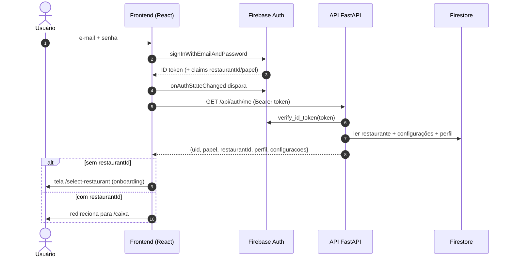
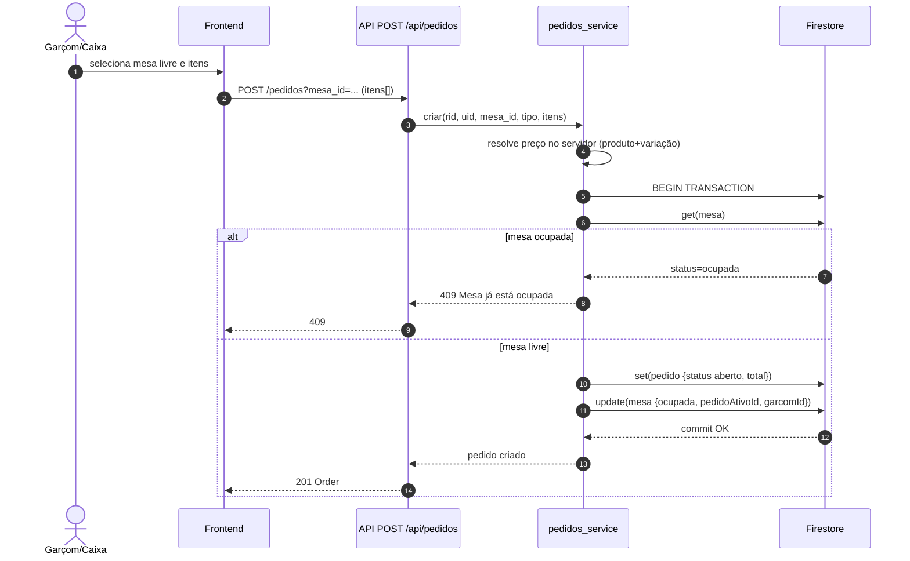
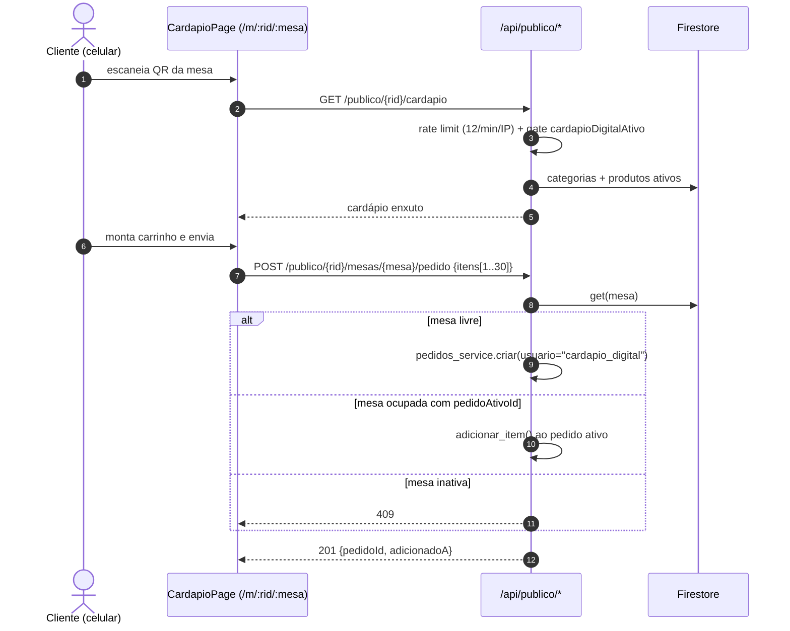
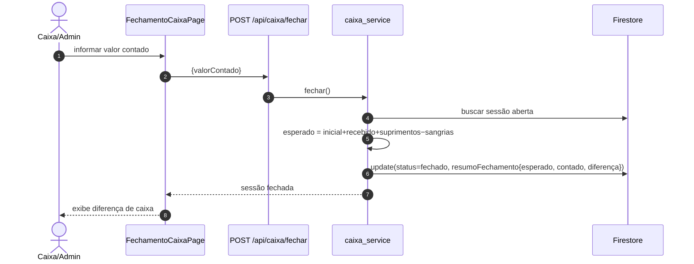

# Diagramas de Sequência — PDV Lanchonete v2

Cenários principais com os atores reais do sistema: **Frontend (React)**, **API (FastAPI)**, **Serviço de domínio**, **Firestore** e, quando aplicável, **Firebase Auth/Impressora**.

---

## 1. Login e carregamento do contexto



## 2. Abrir pedido em mesa (transação anti-corrida)



## 3. Iniciar preparo no KDS — bulk com baixa automática AGREGADA

```mermaid
sequenceDiagram
    autonumber
    actor C as Cozinheiro
    participant FE as Frontend (KDS)
    participant API as PATCH /cozinha/pedidos/{id}/itens/status (BULK)
    participant PS as cozinha_service / pedidos_service
    participant FS as Firestore

    C->>FE: "Iniciar preparo" no cartão (vários itens da mesa)
    FE->>API: PATCH {itemIds[], novoStatus:"preparo"} — 1 chamada
    API->>PS: atualizar_status_itens_bulk(...)
    PS->>FS: BEGIN TRANSACTION
    PS->>FASE 1 — LEITURAS: get(pedido) + itens selecionados
    PS->>FS: get(configuracoes).baixaEstoqueAutomatica
    alt flag ON e itens pendentes sem baixadoEm
        PS->>PS: consumo agregado = Σ receita × qtd por itemId (_consumo_produto)
        Note over PS,FS: FASE 2 — ESCRITAS (leitura 100% antes de escrita 100%, bug 10)
        loop cada ingrediente afetado (uma leitura/escrita por item)
            PS->>FS: set(movimentação saida {qtd, saldoApos, pedidoId})
            PS->>FS: update(estoque saldo = atual − consumo agregado)
        end
        Note over PS,FS: saldo pode ficar negativo; ingrediente inexistente é ignorado
        PS->>FS: update(itens[].baixadoEm = agora) ← idempotência
    else flag OFF ou já baixados
        Note over PS,FS: apenas troca o status
    end
    PS->>FS: update(itens[].status=preparo)
    FS-->>PS: commit
    PS-->>FE: 200 pedido atualizado
```

> A rota antiga `PATCH .../itens/{itemId}/status` delega ao bulk. NUNCA disparar N PATCHes paralelos (contenção de transação — bug 9).

## 4. Pagamento que quita o pedido

```mermaid
sequenceDiagram
    autonumber
    actor X as Operador de Caixa
    participant FE as Frontend (PagamentoPage)
    participant API as POST /api/pagamentos/{pedidoId}
    participant CS as caixa_service
    participant FS as Firestore

    X->>FE: forma + valor (+ recebido p/ troco)
    FE->>API: {tipo:"pix", valor: 42.90}
    API->>CS: registrar_pagamento(...)
    CS->>FS: get(pedido) → status aberto
    CS->>CS: valida tipo; valor ≤ restante+0,01
    CS->>FS: update(pedido.pagamentos += pagamento)
    alt soma ≥ total − 0,01
        CS->>FS: update(pedido.status=pago, fechadoEm)
        CS->>FS: BEGIN TRANSACTION (sessão caixa)
        CS->>FS: query sessoes_caixa where status==aberto
        CS->>FS: update(totalVendas+, totalRecebido+, porForma+, qtdePorProduto+)
        FS-->>CS: commit
        CS->>FS: update(mesa: livre, DELETE_FIELD pedidoAtivoId/garcomId)
    end
    CS-->>API: pedido atualizado
    API-->>FE: 201 (status pago?)
    opt quitado
        FE->>FE: oferece recibo → imprimir() [Bluetooth ESC/POS | janela]
        FE->>X: volta ao mapa de mesas
    end
```

## 5. Pedido pelo cardápio digital (cliente na mesa)



## 6. Onboarding por convite (criação do primeiro restaurante)

```mermaid
sequenceDiagram
    autonumber
    actor A as Novo usuário (admin)
    participant OW as Dono da Plataforma (/plataforma)
    participant FE as SelectRestaurantPage?t=CÓDIGO
    participant API as POST /api/restaurantes/primeiro {token}
    participant RS as restaurantes_service
    participant FS as Firestore
    participant FA as Firebase Auth Admin

    OW->>FS: POST /api/sistema/convites → cria convites/{token}<br/>(expira 7d; guard sistema/global.donoUids)
    A->>FE: abre link com convite + nome + quantidade de mesas
    FE->>API: payload {token, nome, quantidadeMesas}
    API->>RS: criar_primeiro(auth, payload)
    RS->>FS: TRANSACTION única (leituras 100% antes das escritas)
    alt claim restaurantId presente (token novo)
        RS->>RS: marcador completo? → AUTO-CURA:<br/>reemite claims e devolve MESMO restaurante
        RS-->>FE: 200 {restaurantId} (mesmo)
    else sem convite válido e não é dono/bootstrap
        RS-->>API: 403 (ausente/expirado/usado/revogado)
    else convite válido
        RS->>FS: lê marcador + convite + estado
        RS->>FS: set(doc raiz + configurações + docs-pai<br/>+ mesas numeradas + doc admin)
        RS->>FS: set(onboarding/{uid} completo) + update(convite.usadoEm/usadoPorUid)
        FS-->>RS: commit (reuso impossível nem em corrida)
        RS->>FA: set_custom_user_claims(uid, {restaurantId, papel=admin})
        RS-->>FE: 201 {restaurantId}
        FE->>FA: getIdToken(true) — refresh forçado
        FE->>API: GET /auth/me novamente
    end
```

## 7. Fechamento do caixa


