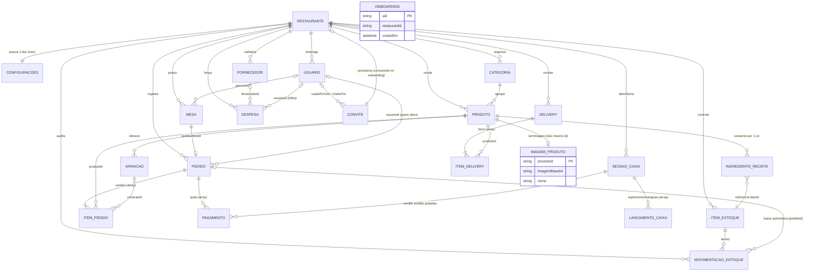

# Modelo Entidade-Relacionamento (MER) — PDV Lanchonete v2

Modelo conceitual do domínio. No Firestore não existem JOINs nem FKs físicas: as cardinalidades são garantidas pela camada de serviços e as referências são por `id`.

## Diagrama

## Dicionário de entidades (atributos principais)

| Entidade | Atributos-chave | Observações |
|---|---|---|
| **RESTAURANTE** | id, nome, criadorUid, criadoEm | Raiz do tenant (`restaurantes/{id}`) |
| **CONFIGURACOES** | nome, moeda, timezone, impressoraTipo/Endereco, baixaEstoqueAutomatica, cardapioDigitalAtivo | Doc único `data/configuracoes` |
| **USUARIO** | id(=uid Auth), nome, email, papel, ativo, tema | Papel ∈ {admin, gerente, caixa, garcom, cozinha}; claims espelham papel |
| **CATEGORIA** | id, nome, ordem, ativo, icone, cor | Ordenação do cardápio |
| **PRODUTO** | id, nome, categoriaId, preco, precisaPreparar(default true), temImagem, imagemUrl?, ativo, estoqueMinimo | Preço-fonte da verdade; foto vive em IMAGEM_PRODUTO |
| **IMAGEM_PRODUTO** | produtoId(=id do doc), imagemBase64 ≤200k chars, mime(jpeg/png/webp), criadoEm | Coleção `imagens/items/{produtoId}` — fora do doc p/ não pesar listagens |
| **VARIACAO** | id, nome, precoAdicional, ativo | Embutida em PRODUTO |
| **INGREDIENTE_RECEITA** | itemId, qtd | Embutida; qtd por 1 unidade do produto |
| **MESA** | id, numero, status, pedidoAtivoId?, garcomId? | status ∈ {livre, ocupada, reservada, inativa} |
| **PEDIDO** | id, mesaId, tipo(local/delivery/balcao), status(aberto/pago/cancelado), total, fechadoEm?, usuarioId? | Agregado raiz |
| **ITEM_PEDIDO** | id, produtoId, variacaoId?, qtd, precoUnitario, observacoes?, status, baixadoEm? | Embutido em PEDIDO; preço congelado no lançamento |
| **PAGAMENTO** | id, tipo(dinheiro/pix/credito/debito), valor, troco?, referencia?, criadoEm | Embutido em PEDIDO; também agregado na sessão |
| **SESSAO_CAIXA** | id, usuarioId, abertoEm, valorInicial, totalVendas, totalRecebido, sangrias, suprimentos, status, resumoFechamento? | Uma aberta por tenant |
| **LANCAMENTO_CAIXA** | id, tipo(suprimento/sangria), valor, observacao?, usuarioId, criadoEm | Embutido na sessão |
| **ITEM_ESTOQUE** | id, nome, unidade, quantidadeAtual, minimo, custoMedio | Saldo pode ser negativo |
| **MOVIMENTACAO_ESTOQUE** | id, tipo(entrada/saida/ajuste), itemId, qtd, saldoApos, pedidoId?, usuarioId | Trilha de auditoria |
| **DELIVERY** | id, externalId, platform, cliente*, itens[], total, status, confirmadoEm/prontoEm/entregueEm | Máquina de estados RN-16 |
| **FORNECEDOR / DESPESA** | ver dicionário do esquema lógico | Despesa tem competência `data` |
| **CONVITE** | token(PK = id do doc), criadoPor, criadoEm, expiraEm(+7d), ativo, usadoEm?, usadoPorUid? | Coleção top-level `convites/{token}`; consumo transacional no onboarding (RN-03/25) |

## Regras de cardinalidade relevantes

1. **RESTAURANTE 1—1 CONFIGURACOES**: documento único por tenant.
2. **MESA 0..1—PEDIDO**: apenas um pedido ativo por mesa; enforced transacionalmente.
3. **PEDIDO 1—* ITEM/PAGAMENTO**: arrays embutidos (padrão agregado); leitura atômica do pedido.
4. **ITEM_ESTOQUE *—MOVIMENTACAO**: histórico imutável com `saldoApos` para reconstrução.
5. **PRODUTO *—ITEM_ESTOQUE** (via receita): N:N resolvida por array embutido de `{itemId, qtd}`.
6. **ONBOARDING (coleção top-level)**: 1 usuário → no máx. 1 restaurante; guard transacional.
7. **PRODUTO 1—0..1 IMAGEM_PRODUTO**: doc de mesmo id em coleção própria; cascade delete.
8. **CONVITE 0..1—RESTAURANTE**: cada convite provisiona no máx. 1 restaurante (uso único transacional).
