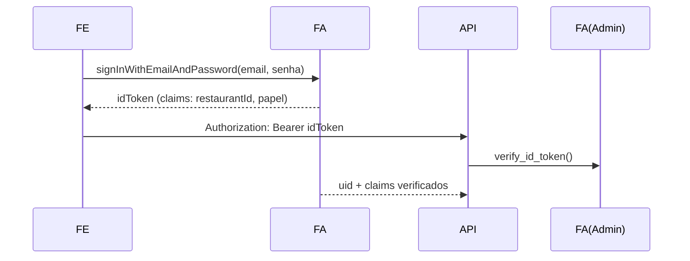

# Documento de Integração de Sistemas — PDV Lanchonete v2

Descreve todas as integrações do sistema: contratos, autenticação, fluxos e tratamento de falhas.

---

## 1. Mapa geral de integrações

| # | Integração | Direção | Tecnologia | Status |
|---|---|---|---|---|
| I-01 | SPA → API interna | saída | HTTP REST `/api/*` (proxy dev) | ✅ Implementada |
| I-02 | SPA ↔ Firebase Auth (login) | bidirecional | Firebase JS SDK (REST por trás) | ✅ Implementada |
| I-03 | API ↔ Firestore | saída | firebase-admin (gRPC/HTTP) | ✅ Implementada |
| I-04 | API ↔ Firebase Auth Admin | saída | verify_id_token, claims, gestão de usuários | ✅ Implementada |
| I-05 | SPA ↔ Firestore (tempo real) | entrada opcional | onSnapshot sob firestore.rules | ✅ Implementada (degrada p/ polling) |
| I-06 | Navegador ↔ Impressora térmica | saída | Web Bluetooth GATT (ESC/POS) | ✅ Implementada |
| I-07 | Plataformas de delivery (iFood/Goomer) | entrada manual | registro manual na tela Delivery | ⏳ Manual (webhook planejado) |
| I-08 | Gateway de pagamento / PIX dinâmico | — | — | ❌ Fora de escopo |

## 2. I-01 — Contrato SPA ⇄ API

- **Base URL**: `/api` no mesmo host do frontend. Em dev, proxy Vite (`/api` → `http://127.0.0.1:8000`, `changeOrigin`). Em produção: rewrite no host (Firebase Hosting) ou reverse proxy.
- **Autenticação**: `Authorization: Bearer <id-token>` em tudo exceto `/api/publico/*` e `/health`.
- **Content-Type**: `application/json`; respostas 204 sem corpo.
- **Erros**: corpo FastAPI `{detail}` normalizado pelo cliente para `ApiError(status, message)`.

Exemplo (cliente):
```ts
const pedido = await api<Order>(`/pedidos/${id}`)
await api(`/pagamentos/${id}`, { method: 'POST', body: { tipo: 'pix', valor: 42.9 } })
```

## 3. I-02/I-04 — Firebase Auth

**Login (client):**


**Custom claims**: gravados apenas via Admin SDK (`set_custom_user_claims`) em onboarding e CRUD de usuários. ⚠️ Claims só aparecem no **próximo** ID token → após mudanças, o frontend chama `getIdToken(true)` e recarrega `/auth/me`.

**Gestão**: criação de usuário operacional usa `create_user(email, senha, display_name)`; remoção lógica usa `update_user(disabled=True)`.

## 4. I-03/I-05 — Firestore

- Caminho canônico: `restaurantes/{rid}/data/{colecao}/items/{doc}` (+ doc único `data/configuracoes`); coleção top-level `onboarding/{uid}`.
- Escritas: **somente** pela API com certificado de service account (`scripts/service-account.json`, caminho configurável).
- Leituras em tempo real do cliente: `collection(db, restaurantes/{rid}/data/{kind}/items)` com regras:
  ```js
  allow read: request.auth != null && request.auth.token.restaurantId == restaurantId;
  ```
  Falha (rules não publicadas/offline) é tratada como warning e o app segue com polling.
- Transações usadas nos pontos críticos (ver arquitetura §4). Batch no onboarding.

## 5. I-06 — Impressão térmica (Web Bluetooth)

| Parâmetro | Valor |
|---|---|
| Service UUID | `000018f0-0000-1000-8000-00805f9b34fb` |
| Characteristic | `00002af1-...` (write/writeWithoutResponse) |
| Fallback | varre todos os serviços procurando characteristic write; se nada, janela `window.print()` |
| Protocolo | ESC/POS: `\x1b@` init · `\x1ba{n}` alinhamento · `\x1bE{n}` negrito · `\x1b!{n}` fonte grande · `\x1dV\x42\x00` corte |
| Chunking | 180 bytes por write |
| Acentos | removidos (NFD) — impressoras ESC/POS não têm mapa UTF-8 pt-BR |

Gatilhos no produto: comanda no KDS (por cartão), recibo ao quitar pagamento, teste em Configurações. Requer Chrome/Edge e HTTPS (ou localhost).

## 6. I-07 — Delivery externo (atual: manual; futuro: webhook)

Hoje o operador registra pedidos iFood/Goomer/WhatsApp manualmente (`platform` restrita a ifood|goomer|whatsapp|proprio — outros valores 422). Contrato interno já preparado para automação:

```json
POST /api/delivery/pedidos
{
  "platform": "ifood",
  "clienteNome": "Maria Silva",
  "clienteTelefone": "1199999-0000",
  "clienteEndereco": "Rua X, 123",
  "itens": [{ "produtoId": "...", "variacaoId": null, "qtd": 1 }],
  "metadata": { "externalOrder": "ifood-abc123" }
}
```

Para webhook futuro: endpoint público dedicado com HMAC/signature da plataforma + mapeamento externalId↔internalId (campo `externalId` já existe).

## 7. Tratamento de falhas entre sistemas

| Falha | Comportamento esperado |
|---|---|
| Token expirado (401) | Cliente exibe mensagem; novo login resolve (token ~1h) |
| Firestore indisponível | API responde 500; PWA serve leituras do cache até 24h |
| onSnapshot bloqueado | warning no console; polling continua |
| Bluetooth ausente/falha | fallback automático janela print; cancelamento explícito não cai no fallback |
| Rate limit público (429) | Cardápio informa "aguarde um instante" |
| Claims defasados | 403 → usuário refaz login (após onboarding/troca de papel o app força refresh automaticamente) |

## 8. Checklist de ambiente para as integrações

- [ ] `.env` do backend: `PROJECT_ID`, `SERVICE_ACCOUNT_PATH` (opcional), `CORS_ORIGINS`
- [ ] Chave `scripts/service-account.json` presente e fora do git
- [ ] Regras publicadas (`firebase deploy --only firestore:rules`)
- [ ] Proxy `/api` ativo no host do frontend
- [ ] HTTPS habilitado onde houver Web Bluetooth/PWA
