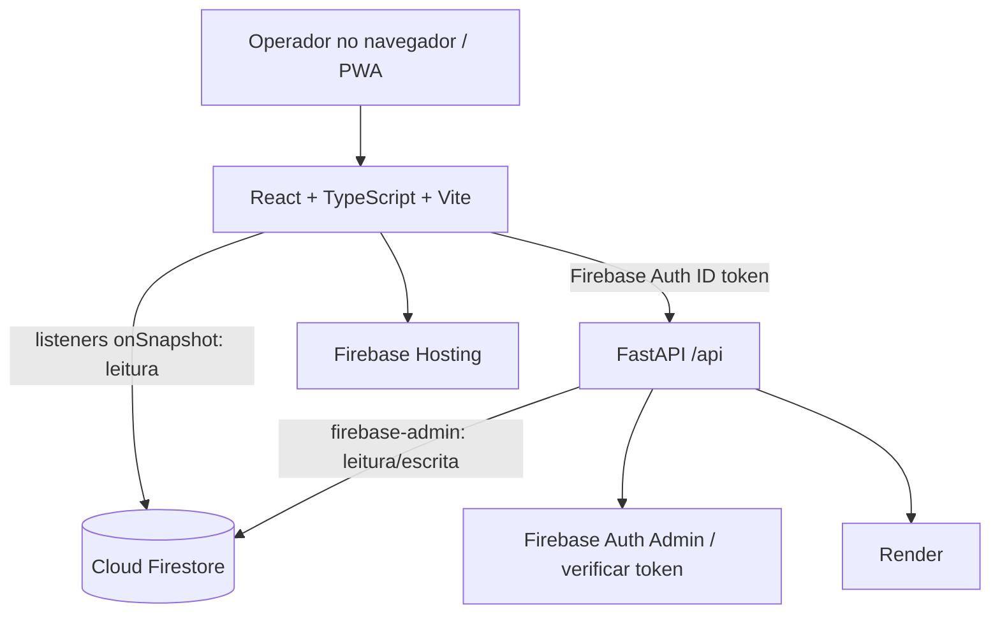

# Arquitetura

## Visão geral

## Responsabilidades

### Frontend

- Renderiza páginas e navegação.
- `AuthContext` observa Firebase Auth e consulta `/api/auth/me`.
- `useFirestore.ts` mantém listeners em coleções selecionadas; normaliza timestamps de Firestore para ISO e adiciona o ID do documento.
- TanStack Query cuida das mutations, estados de carregamento/erro e consultas REST nas telas financeiras e em telas sem listener.
- PWA tem service worker; a documentação informa NetworkFirst para GETs `/api/*`, timeout de 4 s e cache de runtime. O dev server não registra service worker: validar PWA com `npm run build && npm run preview`.

### Backend

- `main.py` cria uma única instância FastAPI, conecta routers sob prefixo `/api`, configura CORS e converte exceções não tratadas em JSON 500.
- `core/security.py` verifica Firebase ID token, extrai `uid`, `restaurantId` e `papel`, e oferece `require_restaurant` e `require_roles`.
- `models/models.py` define contratos Pydantic com aliases camelCase.
- `services/` aplica regras de negócio e acessa Firestore.
- `services/base.py` centraliza caminhos, documentos, timestamps, listagens e paginação.

### Banco

Firestore NoSQL multi-tenant. Caminho canônico:
`restaurantes/{restaurantId}/data/{colecao}/items/{id}`.
Configuração do restaurante é documento `restaurantes/{rid}/data/configuracoes`, não coleção `items`.

## Fluxos de gravação/leitura

- Escritas operacionais passam pela API com Admin SDK; as regras atuais do Firestore negam escrita direta do cliente.
- Leituras de telas de operação podem usar listeners diretos sob regras de tenant.
- Pagamento e algumas alterações financeiras são transacionais; o backend deve manter todas as leituras antes das escritas em cada transação Firestore.
- Os agregados são atualizados junto de eventos de negócio em versões transacionais e usam eventos marcadores para deduplicação quando `evento_id` é fornecido.

## Infraestrutura

- Frontend descrito no README: `https://pdv-lanchonete-1fa79.web.app`.
- API descrita no README: `https://pdv-lanchonete-dwiw.onrender.com`.
- Configuração sensível é provida por ambiente/arquivo local; nunca colocar conteúdo de service account no vault.

## Endpoints de saúde

- `/health`: liveness; não acessa Firestore.
- `/ready`: readiness; tenta ping do Firestore com timeout de 1,5 s e retorna 503 genérico se indisponível.

Fonte principal: `backend/app/main.py`, `backend/app/core/security.py`, `frontend/src/hooks/useFirestore.ts`, `frontend/src/lib/api.ts`.
