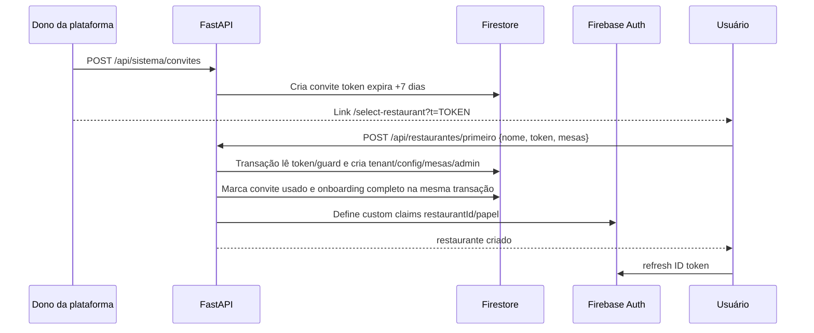

# FL-01 — Criar restaurante por convite

## Invariantes

- Convite é de uso único e expira em 7 dias.
- Validação/consumo e criação essencial precisam estar na mesma transação.
- Admin inicial é associado ao restaurante criado.
- Retry após transação concluída mas claim ausente deve recuperar o mesmo tenant, não criar duplicado.
- Ao receber claims, frontend deve forçar refresh e buscar `/api/auth/me`.

## Testes de regressão

1. Convite válido.
2. Sem token, token inexistente, expirado, revogado e já usado.
3. Duas requisições concorrentes usando o mesmo token.
4. Simular sucesso de dados com falha de claim; retry deve auto-curar.
5. Admin de tenant não pode chamar rotas de convite de plataforma.

Fontes: `restaurantes_service.py`, `convites_service.py`, routers `restaurantes.py`, `sistema.py`, `AuthContext.tsx`.
