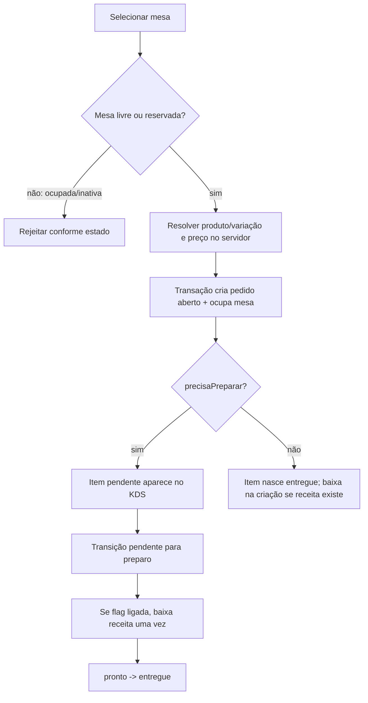

# FL-02 — Abrir mesa, lançar pedido e preparar

## Cuidados

- `pedidoAtivoId` e `garcomId` têm que coincidir com pedido aberto; limpar com `DELETE_FIELD` ao liberar mesa.
- Item em preparo não pode ser removido fisicamente como se pendente fosse.
- Reenvio de status não pode repetir baixa: `baixadoEm` e eventos agregados.
- Ingredientes compartilhados devem ser agregados por itemId antes de escrever.
- Fazer todas as leituras da transação antes de começar qualquer gravação.
- Cancelar item após baixa não estorna estoque automaticamente.

Fontes: `pedidos_service.py`, `cozinha_service.py`, `mesas_service.py`, `calculos.py`.
