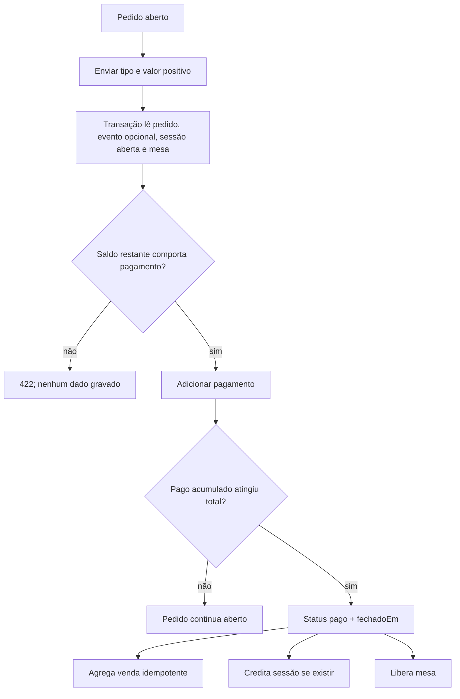

# FL-03 — Receber pagamento e quitar pedido

## Garantias relevantes

- Recalcular saldo dentro da transação evita aceitar dois pagamentos concorrentes baseado no mesmo saldo antigo.
- `X-Idempotency-Key` opcional: replay com a mesma chave deve gerar 409.
- Marcador `venda:{pedidoId}` impede duplicar agregado na quitação repetida quando caller fornece o event ID.
- Sessão inexistente não impede quitação do pedido, mas não existe sessão a creditar.
- A soma de formas de pagamento da sessão soma os pagamentos parciais da venda.

## Critério de aceite

Depois do pagamento final, pedido `pago`, `fechadoEm` preenchido, total na sessão (se aberta), agregados atualizados uma vez, mesa livre e referências ativas removidas.
