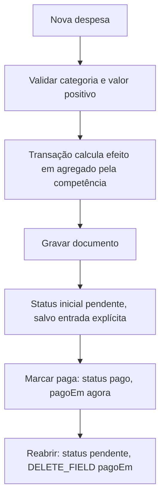

# FL-05 — Registrar e alterar despesa

## Como o agregado deve reagir

- Criar despesa: soma categoria/total no dia e mês de `data`.
- Atualizar valor, categoria ou competência: remover efeito antigo e aplicar o novo em sua competência/categoria.
- Excluir despesa: subtrair contribuição anterior.
- Marcar paga/reabrir: não altera agregado de competência, porque categoria/valor/data não mudaram.
- Service usa evento idempotente associado ao ID/estado da despesa para proteger replays das mutações transacionais.

## Relatório

Despesas são agrupadas por `data` e incluídas mesmo que pendentes. Essa visão é de competência/gerencial, não extrato de caixa.
