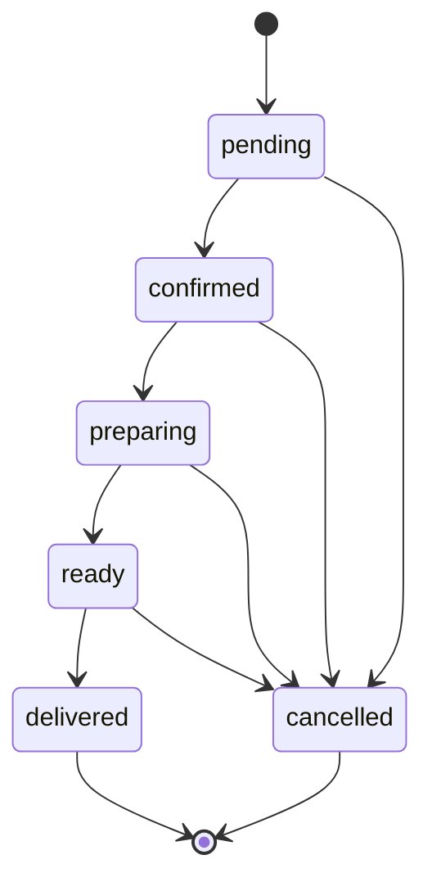

# Delivery

## Plataformas permitidas

`ifood`, `goomer`, `whatsapp`, `proprio`. Valor não suportado deve ser rejeitado pelo modelo/service (documentação de teste cita `uber` como cenário 422).

## Máquina de estados

Transição que não estiver no mapa `TRANSICOES` resulta em 409. `delivered` e `cancelled` são terminais.

## Dados e valores

- Pedido inclui plataforma, ID externo, dados do cliente e itens.
- Serviço resolve nome/variação e preço de cada item pelo catálogo do servidor, calcula total e cria IDs internos.
- Timestamp de estado: `confirmadoEm`, `prontoEm`, `entregueEm` nas transições correspondentes.
- Papéis que criam: admin/gerente/caixa/garçom. Atualização de status inclui cozinha.
- Integração real com plataforma externa não deve ser assumida apenas pelo módulo de status; consultar evidências de integração separadamente.

Fonte: `backend/app/services/delivery_service.py`, `backend/app/routers/delivery.py`, `docs/02-modelagem/diagrama-estados.md`.
